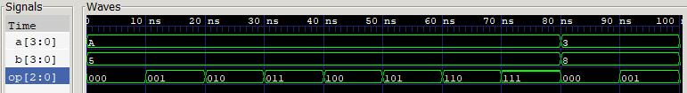
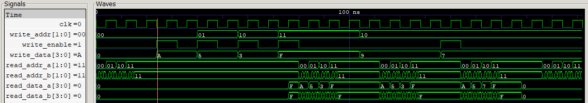
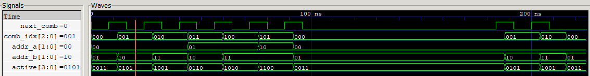
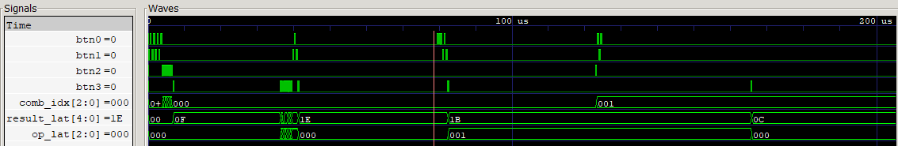
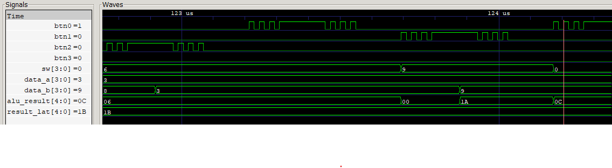

# Laboratorio 03: ALU + Banco de Registros

- **Asignatura:** Electrónica Digital II
- **Semestre:** 2026-2

## Integrantes del equipo

- **Samuel Hincapie Perilla**
- **Eduardo Felipe Camacho Lara**
- **Gabriel Alberto Rodríguez Rincón**

---

## Contenido

1. [Descripción del sistema](#1-descripción-del-sistema)
2. [Interfaz de usuario](#2-interfaz-de-usuario)
3. [Arquitectura modular](#3-arquitectura-modular)
4. [Módulos desarrollados](#4-módulos-desarrollados)
5. [Estrategia de visualización](#5-estrategia-de-visualización)
6. [Asignación de pines](#6-asignación-de-pines)
7. [Simulación](#7-simulación)
8. [Implementación y verificación en FPGA](#8-implementación-y-verificación-en-fpga)
9. [Conclusiones](#9-conclusiones)

---

## 1. Descripción del sistema

El sistema implementa en la Zybo Z7 un pequeño datapath formado por un banco de 4 registros de 4 bits (R0–R3), una ALU de 4 bits con 8 operaciones, un selector automático de pares de operandos y un display de 7 segmentos TM1637 que muestra el resultado.

El flujo de uso es:

1. Se elige el registro de destino con BTN0 (el LED RGB indica cuál está seleccionado).
2. Se coloca un valor en los switches y se escribe en ese registro con BTN1.
3. Con BTN2 se recorren los pares de registros que servirán como operandos A y B (los LEDs LD0–LD3 indican cuáles participan).
4. Se coloca el código de operación en SW[2:0] y se presiona BTN3. La ALU ejecuta la operación generando un resultado de 5 bits (para manejar acarreo en adición y signo en sustracción) y lo captura en el registro de salida. Aunque, si la operación seleccionada es de un solo operando (NOT, ROL, ROR), el sistema ejecuta una escritura acumulativa guardando de forma automática el resultado en el registro asignado como operando A.
5. El display muestra el resultado de la última operación ejecutada y lo conserva hasta la siguiente pulsación de BTN3, aunque cambien los switches, los operandos o el par seleccionado.

---

## 2. Interfaz de usuario

### 2.1 Switches

Los switches cumplen dos funciones en momentos distintos:

| Momento | Switches | Función |
|---|---|---|
| Al presionar **BTN1** | `SW[3:0]` | Dato de 4 bits que se escribe en el registro seleccionado |
| Al presionar **BTN3** | `SW[2:0]` | Código de la operación que ejecuta la ALU |

Como el dato solo se lee al presionar BTN1 y la operación solo al presionar BTN3, compartir los switches no genera conflicto: entre una acción y otra se pueden mover libremente.

### 2.2 Botones

| Botón | Función |
|---|---|
| BTN0 | Selecciona el registro de escritura: R0 → R1 → R2 → R3 → R0 |
| BTN1 | Escribe `SW[3:0]` en el registro seleccionado |
| BTN2 | Avanza al siguiente par de operandos (A, B) |
| BTN3 | Ejecuta la operación `SW[2:0]` y actualiza el resultado del display |

**Nota:** Todas las entradas de los botones (`BTN0`–`BTN3`) pasan internamente por el módulo `debounce.v`. Este implementa un sincronizador de dos etapas, un contador de filtrado configurado a 250,000 ciclos (equivalente a 2 ms a 125 MHz) y un detector de flanco ascendente. Esto garantiza que cada pulsación mecánica entregue exactamente un único pulso limpio (`btn_pulse`) de 1 ciclo de reloj, evitando lecturas múltiples por rebote.

### 2.3 LEDs

Cada LED corresponde a un registro y se enciende si el registro participa en el par de operandos actual:

| Par (A, B) | LD3 | LD2 | LD1 | LD0 |
|---|---|---|---|---|
| (R0, R1) | 0 | 0 | 1 | 1 |
| (R0, R2) | 0 | 1 | 0 | 1 |
| (R0, R3) | 1 | 0 | 0 | 1 |
| (R1, R2) | 0 | 1 | 1 | 0 |
| (R1, R3) | 1 | 0 | 1 | 0 |
| (R2, R3) | 1 | 1 | 0 | 0 |

### 2.4 LED RGB

Indica el registro seleccionado para escritura:

| Registro | Color | R | G | B |
|---|---|---|---|---|
| R0 | Rojo | 1 | 0 | 0 |
| R1 | Verde | 0 | 1 | 0 |
| R2 | Azul | 0 | 0 | 1 |
| R3 | Blanco | 1 | 1 | 1 |

### 2.5 Display TM1637

El driver adapta la representación en los 4 dígitos físicos del display según el tipo de operación:

**Modo Decimal con Signo (`ADD`, `SUB`, `AND`, `OR`, `XOR`):**
   - **Formato:** `[DIG3: Apagado] [DIG2: Signo] [DIG1: Decenas] [DIG0: Unidades]`
   - **Resta:** Si el resultado de 5 bits indica valor negativo (bit 4 en `1`), el dígito izquierdo (`DIG2`) enciende el segmento de signo negativo (`-`) y la magnitud en complemento a 2 se convierte a decimal.
   
**Modo Binario Directo (`NOT`, `ROL`, `ROR`):**
   - **Formato:** `[DIG3: Bit 3] [DIG2: Bit 2] [DIG1: Bit 1] [DIG0: Bit 0]`
   - Los 4 dígitos muestran de forma directa la palabra binaria resultante de 4 bits.
---

## 3. Arquitectura modular


El sistema se diseñó bajo el principio de división de responsabilidades, descomponiendo la arquitectura en módulos independientes y reutilizables. El módulo superior `top.v` actúa exclusivamente como interconexión estructural: no contiene lógica combinacional ni secuencial propia, limitándose a declarar señales internas, instanciar los bloques y mapearlos a los pines de la FPGA Zybo Z7.

### 3.1 Resumen de Módulos

| Módulo | Tipo de lógica | Responsabilidad |
|---|---|---|
| `debounce.v` | Secuencial | Sincroniza cada botón, filtra el rebote y entrega un pulso de un ciclo por pulsación |
| `write_selector.v` | Secuencial + combinacional | Registro de escritura seleccionado (BTN0) y color del LED RGB |
| `comb_selector.v` | Secuencial + combinacional | Índice del par de operandos (BTN2), direcciones de lectura y LEDs |
| `reg_bank.v` | Secuencial | 4 registros de 4 bits, 1 puerto de escritura y 2 de lectura |
| `alu.v` | Combinacional | Las 8 operaciones aritméticas y lógicas |
| `exec_unit.v` | Secuencial + combinacional | Decide qué se escribe en el banco y guarda el resultado ejecutado (BTN3) |
| `display_tm1637.v` | Secuencial | Módulo de visualización; contiene `tm1637_driver.v`, que convierte el resultado y lo envía al display |
| `top.v` | Solo conexiones | Integración con los pines de la tarjeta |

### 3.2 Flujo de Datos y Control

El procesamiento de información sigue la siguiente secuencia:

1. **Acondicionamiento de entradas:** Las pulsaciones asíncronas de los botones pasan por `debounce` y se convierten en los pulsos `btn0_p` … `btn3_p`.
2. **Selección de operandos:** `comb_selector.v` entrega las direcciones `addr_a` y `addr_b`, permitiendo que `reg_bank.v` exponga de forma inmediata los datos `read_data_a` y `read_data_b` en las entradas de la ALU.
3. **Cálculo combinacional:** La `alu.v` procesa continuamente `read_data_a`, `read_data_b` y la operación seleccionada en `SW[2:0]`. Su salida permanece aislada hasta que se decida capturarla.
4. **Captura y Retención:** Al presionar `BTN3`, la `exec_unit.v` recibe el pulso `btn3_p`, almacena el resultado de 5 bits y el código de operación en sus registros de salida (`result_lat` y `op_lat`) y los envía a `display_tm1637.v`
5. **Realimentación / Escritura:** La `exec_unit.v` controla la escritura en el banco:
   - Con `btn1_p`: escribe el valor presente en `SW[3:0]` en el registro seleccionado por `write_selector.v`.
   - Con `btn3_p`: si la operación es unaria (`NOT`, `ROL`, `ROR`), escribe automáticamente el resultado de la ALU de vuelta en el registro A.

**Nota:** Todos los tiempos que dependen de contadores de reloj (ventana del antirrebote y divisor de frecuencia del bus TM1637) están parametrizados en los módulos superiores (`top.v` y `tb_top.v`). Para la síntesis en hardware se emplean los valores reales (125 MHz); mientras que en la simulación los parámetros se escalan hacia abajo, permitiendo validar el funcionamiento en GTKWave en escala de microsegundos en lugar de segundos.

---

## 4. Módulos desarrollados

### 4.1 `alu.v`: ALU combinacional

Recibe dos operandos de 4 bits (`a` y `b`) y entrega un resultado de 5 bits (`result`). El bit adicional (`result[4]`) conserva el acarreo de la suma y la extensión de signo de la resta, los cuales se perderían con una salida de 4 bits.

| `op` | Operación | Resultado | Rango | Ejemplo (A = 10, B = 5) |
|---|---|---|---|---|
| `000` | ADD | $A + B$ | 0 a 30 | 15 |
| `001` | SUB | $A - B$ (complemento a 2 en 5 bits) | −15 a 15 | 5 |
| `010` | AND | $A \land B$ bit a bit | 0 a 15 | 0 |
| `011` | OR | $A \lor B$ bit a bit | 0 a 15 | 15 |
| `100` | XOR | $A \oplus B$ bit a bit | 0 a 15 | 15 |
| `101` | NOT | $\overline{A}$ | 0 a 15 | 5 |
| `110` | ROL | Rotación de A a la izquierda (el bit 3 pasa al bit 0) | 0 a 15 | 5 |
| `111` | ROR | Rotación de A a la derecha (el bit 0 pasa al bit 3) | 0 a 15 | 5 |

NOT, ROL y ROR operan exclusivamente sobre el operando A.

En todas las operaciones lógicas y de desplazamiento, el bit más significativo `result[4]` se rellenante explícitamente con `1'b0`.

La resta se calcula extendiendo los operandos a 5 bits, por lo que el bit 4 queda como bit de signo en complemento a 2. Por ejemplo, $3 - 8 = -5$, que en complemento a 2 de 5 bits es $11011_2 = 27$; el display interpreta ese valor como −5 (sección 5).

El módulo usa `always @(*)`, no tiene reloj ni registros, y todas las ramas del `case` asignan `result`, por lo que no se infieren latches.

### 4.2 `reg_bank.v`: banco de registros

Almacena los datos temporales del sistema mediante las siguientes especificaciones:
- Contiene 4 registros de 4 bits ($R_0, R_1, R_2, R_3$), inicializados en cero (`4'h0`).
- **Escritura síncrona:** En el flanco de subida del reloj, si `write_enable = 1`, se guarda `write_data` en `regs[write_addr]`.
- **Dos puertos de lectura combinacionales:** Entregan de forma asíncrona e inmediata los datos `read_data_a = regs[read_addr_a]` y `read_data_b = regs[read_addr_b]` a las entradas de la ALU.

### 4.3 `comb_selector.v`: selector de operandos

Genera las 6 combinaciones de pares sin repetición de los 4 registros:

$$\binom{4}{2} = \frac{4!}{2!\,2!} = 6$$

Un índice interno `comb_idx` (0 a 5) avanza con cada pulso de BTN2 y vuelve a 0 después del 5. Una tabla convierte el índice en las direcciones `addr_a` y `addr_b`. La salida `active` enciende los dos LEDs de los registros participantes:

```verilog
assign active = (4'b0001 << addr_a) | (4'b0001 << addr_b);
```

En cada par, A siempre es el registro de menor índice. Por eso la resta se calcula como R(menor) − R(mayor); para obtener la resta en el otro sentido basta con intercambiar los valores escritos en los registros.

### 4.4 `debounce.v`: acondicionamiento de botones

Cada botón físico pasa por tres etapas de procesamiento:

1. **Sincronizador de 2 Flip-Flops:** Aísla la entrada asíncrona del botón respecto al reloj principal de la FPGA para evitar estados de metaestabilidad.
2. **Filtro de rebote:** Un cambio de nivel en la señal solo se valida si se mantiene estable durante `N_CYCLES` ciclos de reloj consecutivos. Si la señal rebota, el contador interno se reinicia.
3. **Detector de flanco ascendente:** Una vez confirmada la transición de `0` a `1`, la salida `btn_pulse` se activa durante **un solo ciclo de reloj**.

Con el valor por defecto configurado para la frecuencia de la Zybo Z7 (125 MHz), el tiempo de filtrado se calcula mediante:

$$t_{db} = N_{cycles} \cdot T_{clk} = 250\,000 \cdot 8\ \text{ns} = 2\ \text{ms}$$

El pulso de un ciclo es indispensable para los controles del sistema (`BTN0`, `BTN2`, `BTN3`). A 125 MHz, una pulsación manual típica de unos 200 ms equivale a: $0.2\ \text{s} / 8\ \text{ns} = 25 \times 10^{6}$ ciclos de reloj

Sin el detector de flanco, los registros o el índice de combinación avanzarían millones de posiciones por cada pulsación.

### 4.5 `write_selector.v`: registro de escritura

Consiste en un contador secuencial de 2 bits que avanza circularmente con cada pulso de **BTN0** (R0 → R1 → R2 → R3 → R0). 

Mapea directamente la dirección del registro objetivo hacia las salidas del **LED RGB** (`led_r`, `led_g`, `led_b`), permitiendo identificar visualmente cuál registro está seleccionado para escritura:

| Registro Objetivo | Color del LED RGB | R | G | B |
| :--- | :--- | :-: | :-: | :-: |
| **R0** | Rojo | 1 | 0 | 0 |
| **R1** | Verde | 0 | 1 | 0 |
| **R2** | Azul | 0 | 0 | 1 |
| **R3** | Blanco | 1 | 1 | 1 |

### 4.6 `exec_unit.v`: escritura y resultado guardado

Este módulo centraliza el control de escrituras en el banco y la retención del resultado mostrado en pantalla mediante dos funciones principales:

a) Árbitro de escritura del banco

Determina la procedencia de la señal de escritura (`we`), la dirección (`waddr`) y el dato (`wdata`) según el evento ocurrido:

| Evento | `write_enable` (`we`) | Dirección (`waddr`) | Dato de Escritura (`wdata`) |
| :--- | :-: | :--- | :--- |
| **BTN1** (Carga manual) | `1` | Registro seleccionado por BTN0 (`write_sel`) | Valor de los switches `SW[3:0]` |
| **BTN3** con `NOT`, `ROL` o `ROR` | `1` | Registro A del par actual (`addr_a`) | Resultado de la ALU (`alu_result[3:0]`) |
| **BTN3** con `ADD`, `SUB`, `AND`, `OR` o `XOR` | `0` | — | — |

Las operaciones de un solo operando se escriben de vuelta en el registro A para que sean **acumulativas**: presionar BTN3 varias veces con ROL sigue rotando el mismo registro, y NOT dos veces devuelve el valor original. Las operaciones de dos operandos no modifican los registros. Como NOT, ROL y ROR siempre producen resultados de 4 bits, el valor escrito cabe en el registro sin pérdida.

La condición para identificar operaciones unarias se implementa mediante la expresión lógica:

```verilog
wire single_op = (sw[2:0] == 3'b101) | (sw[2:1] == 2'b11);
```

b) Registro del resultado

Las señales `result_lat` y `op_lat` se actualizan únicamente cuando se detecta el pulso `exec_pulse` (BTN3). Aunque la ALU recalcula continuamente de forma combinacional, el módulo de visualización recibe únicamente estos registros retenidos, garantizando que el display conserve la última operación ejecutada aunque cambien posteriormente los switches, el par de registros o el contenido del banco.

```verilog
always @(posedge clk) begin
    if (exec_pulse) begin
        result_lat <= alu_result;
        op_lat     <= sw[2:0];
    end
end
```

### 4.7 `display_tm1637.v` y `tm1637_driver.v`: display

El módulo `display_tm1637` es un módulo de visualización que instancia al controlador `tm1637_driver`, el cual cumple dos tareas centrales:

1. **Conversión del resultado a los 4 dígitos:** Mapea el resultado retenido de 5 bits y el código de operación a los patrones de 7 segmentos de cada dígito.
2. Comunicación con el TM1637 mediante una máquina de estados que genera el protocolo de 2 hilos (CLK y DIO).

El protocolo del TM1637 es parecido a I²C, pero sin dirección de dispositivo y con los datos LSB primero. Cada refresco envía tres transacciones:

| Transacción | Bytes | Significado |
|---|---|---|
| 1 | `0x40` | Modo escritura con autoincremento de dirección |
| 2 | `0xC0`, d3, d2, d1, d0 | Dirección del primer dígito y los 4 patrones de segmentos |
| 3 | `0x8F` | Display encendido, brillo máximo |

Cada transacción inicia con la condición START (DIO pasa a bajo mientras CLK se mantiene en alto) y finaliza con la condición STOP (DIO pasa a alto mientras CLK está en alto). Los bits cambian en DIO cuando CLK está en bajo y son muestreados en el flanco de subida de CLK. Tras cada byte enviado, existe un noveno pulso de confirmación (ACK), durante el cual el driver libera la línea (`tm_dio = 1'bz`).

Con `TM_BIT_HZ` = 10 kHz, el driver avanza un estado cada:

$$t_{tick} = \frac{1}{2 \cdot TM_{bit}} = \frac{1}{2 \cdot 10\ \text{kHz}} = 50\ \mu\text{s}$$

Un bit ocupa 3 estados (150 µs) y una trama completa unos 220 estados (≈ 11 ms). Entre tramas se esperan `REFRESH_TICKS` = 2000 estados (100 ms), así que el display se refresca unas 9 veces por segundo, muy por encima de lo necesario para un valor que solo cambia con BTN3.

---

## 5. Estrategia de visualización

El display TM1637 consta de 4 dígitos físicos de 7 segmentos. La representación visual se adapta dinámicamente según el tipo de operación ejecutada para permitir una lectura intuitiva y sin ambigüedades:

| Operaciones | Representación | Dígito 3 (Izq.) | Dígito 2 | Dígito 1 | Dígito 0 (Der.) |
| :--- | :--- | :--- | :--- | :--- | :--- |
| **ADD, SUB, AND, OR, XOR** | **Decimal con Signo** |(Apagado) | Signo | Decenas (0 a 3) | Unidades (0 a 9) |
| **NOT, ROL, ROR** | **Binario Directo** | Bit 3 | Bit 2 | Bit 1 | Bit 0 |

A. **Modo Decimal con Signo:**
   - Se aplica a las operaciones aritméticas (`ADD`, `SUB`) y lógicas (`AND`, `OR`, `XOR`) para mostrar la magnitud final de forma numéricamente directa.
   - **Formato numérico:** El dígito menos significativo (`DIG0`) representa las unidades y el dígito contiguo (`DIG1`) las decenas, permitiendo leer el resultado de forma natural como un entero decimal de derecha a izquierda.

B. **Modo Binario Directo:**
   - Se utiliza en `NOT`, `ROL` y `ROR` porque son transformaciones bit a bit. Representar operaciones de desplazamiento en decimal ocultaría la manipulación de los bits (por ejemplo, ver $0101 \to 1010$ es inmediato en binario, mientras que en decimal se leería ambiguamente como 5 a 10).

### 5.1 Interpretación del Resultado de 5 Bits

La ALU entrega una salida de 5 bits (`result[4:0]`), cuya interpretación varía según la operación:

| Operación | Tipo de Dato | Rango Útil | Cálculo de la Magnitud Mostrada |
| :--- | :--- | :-: | :--- |
| **ADD** | Sin signo (5 bits) | 0 a 30 | El valor directo `result[4:0]` |
| **SUB** | Con signo (Complemento a 2) | -15 a +15 | Si `result[4] == 1`: activa signo `-` y calcula magnitud como $\overline{r} + 1$ |
| **AND, OR, XOR** | Sin signo (4 bits) | 0 a 15 | Los 4 bits menos significativos `result[3:0]` |

### Ejemplo de Cálculo en Sustracción Negativa:
Para la operación $3 - 8$, la ALU entrega $11011_2$ (27). Al ser una sustracción (`SUB`), el sistema evalúa el bit de signo (`result[4] = 1`):
-  **Activación de signo:** El dígito 3 (`DIG3`) enciende el segmento negativo (`-`).
-  **Obtención de la magnitud:** $\overline{11011}_2 + 1 = 00100_2 + 1 = 00101_2 = 5_{10}$
-  **Proyección en pantalla:** El display muestra `-  5` (Signo `-`, Decenas `0`, Unidades `5`).

La conversión a decenas y unidades se hace con una tabla de búsqueda (0 a 30), sin divisiones, para que la síntesis sea sencilla.

### 5.2 Ejemplos de Visualización:

| Operación | Resultado guardado | Display |
|---|---|---|
| ADD 10 + 5 | 15 | ` 15` |
| ADD 15 + 15 | 30 | ` 30` |
| SUB 10 − 5 | 5 | ` 05` |
| SUB 3 − 8 | 27 (−5) | `-05` |
| AND 10 & 5 | 0 | ` 0` |
| NOT 1010 | 0101 | `0101` |
| ROL 0101 | 1010 | `1010` |

---

## 6. Asignación de pines

| Puerto | Pin | Componente |
|---|---|---|
| `clk` | K17 | Reloj de 125 MHz (`create_clock -period 8.00`) |
| `sw[0]` – `sw[3]` | G15, P15, W13, T16 | Switches SW0–SW3 |
| `btn0` – `btn3` | K18, P16, K19, Y16 | Botones BTN0–BTN3 |
| `led[0]` – `led[3]` | M14, M15, G14, D18 | LD0–LD3 (registros activos) |
| `led_r`, `led_g`, `led_b` | V16, F17, M17 | LED RGB LD6 (registro de escritura) |
| `tm_clk` | V12 | Pmod JE, pin 1 → CLK del TM1637 |
| `tm_dio` | W16 | Pmod JE, pin 2 → DIO del TM1637 (con `PULLUP true`) |

El módulo TM1637 se alimenta desde el mismo Pmod JE: VCC en el pin 6 (3.3 V) y GND en el pin 5.

---

## 7. Simulación

Cada módulo del sistema se probó de manera independiente mediante un *testbench* dedicado antes de realizar la simulación integrada con el archivo superior `top.v`. Los testbenches evalúan automáticamente las salidas contra modelos de referencia e imprimen en consola el resultado `PASO` o `FALLO`.

| Testbench | Módulo Bajo Prueba | Verificación Realizada |
| :--- | :--- | :--- |
| `tb_alu.v` | `alu.v` | Evalúa las 8 operaciones con las 256 combinaciones de A y B (2058 casos de prueba total). |
| `tb_reg_bank.v` | `reg_bank.v` | Escritura en los 4 registros, lectura simultánea por ambos puertos, verificación de `write_enable = 0`, sobrescritura y `reset`. |
| `tb_comb_selector.v` | `comb_selector.v` | Recorrido de los 6 pares de operandos, retorno circular a (R0, R1), máscara de LEDs `active`, retención sin pulso y `reset`. |
| `tb_display_tm1637.v` | `display_tm1637.v` | Decodificación del protocolo serie del bus TM1637 y validación de dígitos en 9 escenarios de prueba. |
| `tb_top.v` | `top.v` (Sistema completo) | Flujo completo con pulsaciones reales con rebote: carga de registros, combinaciones, operaciones ALU, retención del resultado, LEDs, RGB y display. |

### Modelo de Verificación del Bus: `tm1637_monitor.v`
Para validar la comunicación serie sin requerir el hardware físico, se desarrolló el módulo de verificación `tm1637_monitor.v`. Este bloque observa las líneas físicas `tm_clk` y `tm_dio`, detecta las condiciones de `START` y `STOP`, ensambla los bytes recibidos (orden LSB primero) y extrae los patrones transmitidos a los 4 dígitos. De esta forma, la simulación valida lo que realmente viaja por el bus físico.

### Escalado de Parámetros para Simulación
Para evitar tiempos excesivos de simulación y facilitar la inspección visual en GTKWave, se redujeron los parámetros temporales en el entorno de pruebas:

| Parámetro | Valor en Síntesis (FPGA) | Valor en Simulación (Testbench) |
|---|---|---|
| `DEBOUNCE_CYCLES` | 250 000 (2 ms) | 8 |
| `TM_BIT_HZ` | 10 kHz | 6.25 MHz |
| `TM_REFRESH_TICKS` | 2000 | 50 |

### Comandos de Compilación y Ejecución (Icarus Verilog + GTKWave)
```bash
iverilog -g2005 -o s_alu  tb_alu.v ../src/alu.v
iverilog -g2005 -o s_rb   tb_reg_bank.v ../src/reg_bank.v
iverilog -g2005 -o s_cs   tb_comb_selector.v ../src/comb_selector.v
iverilog -g2005 -o s_disp tb_display_tm1637.v tm1637_monitor.v ../src/display_tm1637.v ../src/tm1637_driver.v
iverilog -g2005 -o s_top  tb_top.v tm1637_monitor.v ../src/top.v ../src/debounce.v ../src/write_selector.v ../src/comb_selector.v ../src/reg_bank.v ../src/alu.v ../src/exec_unit.v ../src/display_tm1637.v ../src/tm1637_driver.v
vvp s_top
gtkwave tb_top.vcd
```

### 7.1 ALU

```
a=10 b= 5 op=000 -> result=01111 (15)
a=10 b= 5 op=001 -> result=00101 (5)
a=10 b= 5 op=010 -> result=00000 (0)
a=10 b= 5 op=011 -> result=01111 (15)
a=10 b= 5 op=100 -> result=01111 (15)
a=10 b= 5 op=101 -> result=00101 (5)
a=10 b= 5 op=110 -> result=00101 (5)
a=10 b= 5 op=111 -> result=00101 (5)
a= 3 b= 8 op=000 -> result=01011 (11)
a= 3 b= 8 op=001 -> result=11011 (27)
--------------------------------------------
ALU: PASO - 2058 casos
```



> _[Captura de GTKWave: `a`, `b`, `op` y `result`, primeros 100 ns]_

Con A y B fijos, `result` cambia en el mismo instante que `op`, lo que confirma que la ALU es combinacional. En el caso $3 - 8$ aparece $11011_2$, el −5 en complemento a 2 de 5 bits.

### 7.2 Banco de registros

```
Escritura R0..R3 = A, 5, 3, F verificada
write_enable = 0 no modifica los registros
Sobrescritura de R2 verificada
Reset verificado
--------------------------------------------
REG_BANK: PASO
```



> _[Captura de GTKWave: `clk`, `we`, `waddr`, `wdata`, `ra`, `rb`, `da`, `db`]_

Se valida la escritura síncrona en los registros en el flanco de subida de clk únicamente cuando `write_enable = 1`. La lectura por los dos puertos independientes (`read_data_a` y `read_data_b`) es inmediata y asíncrona.

### 7.3 Selector de combinaciones

```
OK idx=0: (R0, R1)  LEDs=0011
OK idx=1: (R0, R2)  LEDs=0101
OK idx=2: (R0, R3)  LEDs=1001
OK idx=3: (R1, R2)  LEDs=0110
OK idx=4: (R1, R3)  LEDs=1010
OK idx=5: (R2, R3)  LEDs=1100
OK idx=0: (R0, R1)  LEDs=0011
...
COMB_SELECTOR: PASO
```



> _[Captura de GTKWave: `next`, `idx`, `aa`, `ab`, `active`]_

Cada pulso de `next_comb` incrementa `comb_idx` en 1 y actualiza las direcciones de lectura `addr_a` y `addr_b`. Al llegar a la combinación 5 (R2, R3), el siguiente pulso reinicia el contador a 0 (R0, R1). La señal `active` enciende exactamente los 2 LEDs correspondientes.

### 7.4 Display

| Entrada | Bytes recibidos (d3 d2 d1 d0) | Display |
|---|---|---|
| ADD, 15 | `00 06 6D 3F` | ` 150` |
| ADD, 30 | `00 4F 3F 3F` | ` 300` |
| SUB, +5 | `00 3F 6D 06` | ` 051` |
| SUB, −5 | `40 3F 6D 06` | `-051` |
| SUB, −15 | `40 06 6D 06` | `-151` |
| AND, 0 | `00 3F 3F 5B` | ` 002` |
| XOR, 15 | `00 06 6D 66` | ` 154` |
| NOT, 0101 | `3F 06 3F 06` | `0101` |
| ROL, 1010 | `06 3F 06 3F` | `1010` |

**NOTA:** `0x40` representa el segmento de signo negativo (-), `0x00` indica dígito apagado, y los demás valores mapean la codificación de 7 segmentos de los dígitos 0 a 9.


> _[Captura de GTKWave con zoom en una trama: `tm_clk`, `tm_dio`, `state`, `cur_byte`]_

#### A. Respuesta de las Señales ante Operaciones de la ALU
En las formas de onda se observan 3 intervalos principales de $30\ \mu\text{s}$ donde las entradas `result[4:0]` y `op_code[2:0]` cambian para validar los distintos modos de visualización:

| Intervalo de Tiempo | Entradas (`result` / `op_code`) | Modo de Operación | Procesamiento de la FPGA | Lo que muestra el Display |
| :--- | :--- | :--- | :--- | :--- |
| **$0\ \mu\text{s}$ a $30\ \mu\text{s}$** | `result = 0F` ($15$)<br>`op_code = 000` (`ADD`) | Decimal Positivo | La LUT BCD separa el $15$ en decenas ($1$) y unidades ($5$). | `  15`<br>(Alineado a la derecha) |
| **$30\ \mu\text{s}$ a $60\ \mu\text{s}$** | `result = 1B` ($11011_2$)<br>`op_code = 001` (`SUB`) | Decimal Negativo | Detecta `result[4] = 1` (signo negativo). Calcula la magnitud absolutaf $\vert{}-5\vert{} = 5$ y activa el segmento `-`. | `-  5`<br>(Signo `-` y dígito 5) |
| **$60\ \mu\text{s}$ a $90\ \mu\text{s}$** | `result = 05` ($00101_2$)<br>`op_code = 110` (`ROL`) | Binario Directo | Desactiva la conversión BCD y asigna cada bit de `result[3:0]` directamente a un dígito. | `0101`<br>(Un bit en cada dígito) |

#### B. Anatomía Detallada del Paquete y Mapeo de LEDs (Protocolo TM1637)

Para interpretar la transmisión serie en GTKWave y comprender cómo la FPGA controla los números del display utilizando únicamente dos cables (`tm_clk` y `tm_dio`), es necesario desglosar la información desde el LED individual hasta la estructura completa del bus serie.

#### Codificación de Segmentos (Mapeo de Bits a LEDs)

Cada uno de los 4 dígitos físicos consta de 8 LEDs independientes: 7 segmentos principales para representar los números y un punto decimal (`dp`).

```text
       --- a ---
      |         |
      f         b
      |         |
       --- g ---
      |         |
      e         c
      |         |
       --- d ---   . (dp)
```

La FPGA empaqueta el estado de encendido (`1`) o apagado (`0`) de los 8 LEDs en un único byte de datos, siguiendo el siguiente mapeo:

| Bit | Bit 7 | Bit 6 | Bit 5 | Bit 4 | Bit 3 | Bit 2 | Bit 1 | Bit 0 |
|:---:|:-----:|:-----:|:-----:|:-----:|:-----:|:-----:|:-----:|:-----:|
| Segmento | dp | g | f | e | d | c | b | a |

**Ejemplo 1: Dígito '5'**

Se encienden los segmentos `a`, `f`, `g`, `c` y `d`.

$$
[\text{dp},g,f,e,d,c,b,a]=[0,1,1,0,1,1,0,1]
$$

$$
01101101_2 = \boxed{0x6D}
$$

**Ejemplo 2: Signo negativo '-'**

Se enciende únicamente la barra central `g`.

$$
[\text{dp},g,f,e,d,c,b,a]=[0,1,0,0,0,0,0,0]
$$

$$
01000000_2 = \boxed{0x40}
$$

#### Relación entre Señales Físicas (`tm_clk`, `tm_dio`) y el Display

El chip controlador TM1637 actúa como un dispositivo de conversión serie-paralelo, transformando la transmisión de datos mediante dos líneas en las señales de control necesarias para los 32 LEDs del módulo físico.

- **`tm_clk` (Reloj síncrono):** Marca la cadencia de la transmisión. En cada flanco de subida de `tm_clk`, el receptor TM1637 muestrea y almacena el estado presente en la línea de datos.

- **`tm_dio` (Línea de datos serie):** Transporta la información de los segmentos bit por bit, en orden LSB primero (*Least Significant Bit*). Un nivel alto (`3.3 V`) representa un `1`, mientras que un nivel bajo (`0 V`) representa un `0`.

#### Estructura de las 3 Transacciones por Ráfaga

Cada ciclo de actualización completo generado por la FSM produce 3 transacciones consecutivas, delimitadas por condiciones de `START` y `STOP`.

**Estructura general de la ráfaga de refresco:**

```text
[RÁFAGA COMPLETA DE REFRESCO]
   |
   ├── 1. Transacción de Configuración (Comando 0x40)
   |
   ├── 2. Transacción de Datos (Comando 0xC0 + DIG3 + DIG2 + DIG1 + DIG0)
   |
   └── 3. Transacción de Control de Pantalla (Comando 0x8F)
```

**Transacción 1: Configuración de Modo (0x40)**

```text
[START] -> Envía 0x40 -> [STOP]
```

**Función:** Indica al chip TM1637 que opere en modo de escritura de datos con incremento automático de dirección, permitiendo recorrer secuencialmente las posiciones de memoria correspondientes a los 4 dígitos.

**Transacción 2: Ráfaga de Datos de Segmentos (0xC0 + 4 Bytes)**

```text
[START] -> Envía 0xC0 -> Byte DIG3 -> Byte DIG2 -> Byte DIG1 -> Byte DIG0 -> [STOP]
```

**Función:** El comando `0xC0` establece la dirección de memoria base (dígito 3, extremo izquierdo). A continuación, la FPGA transmite consecutivamente los 4 bytes codificados con los patrones de encendido de los LEDs para los dígitos 3, 2, 1 y 0.

**Transacción 3: Control de Encendido y Brillo (0x8F)**

```text
[START] -> Envía 0x8F -> [STOP]
```

**Función:** Activa las salidas del display e ilumina los segmentos al 100 % de brillo. Mantener la pantalla apagada durante la transmisión previa permite evitar parpadeos visuales (*flicker*) durante la actualización.

#### Confirmación por Acuse de Recibo (ACK - 9.º Pulso de Reloj)

La transmisión de cada byte individual en el bus requiere 9 ciclos de `tm_clk`, y no solamente 8. Los primeros 8 ciclos corresponden a los bits de información, mientras que el noveno se utiliza para la confirmación de recepción (ACK).

**Pulsos 1 al 8:** La FPGA mantiene el control de la línea `tm_dio` y transmite los 8 bits de datos secuencialmente, comenzando por el bit menos significativo (LSB).

**Pulso 9 (ACK):** Durante el noveno pulso de reloj, la FPGA conmuta el puerto `tm_dio` a alta impedancia (`1'bz`), liberando la línea de datos. Si el chip TM1637 recibió correctamente el byte, lleva la línea `tm_dio` a nivel bajo (`0 V`), generando el pulso de confirmación ACK que indica que el dispositivo ha reconocido la transmisión.

Este mecanismo permite verificar el acoplamiento y la comunicación entre la FPGA y el controlador del display.

#### C. Mecanismo de Refresco Continuo
Las ráfagas de pulsos se repiten periódicamente debido a:
1. **Bucle de la FSM (`ST_WAIT`):** El módulo `tm1637_driver` opera en un ciclo continuo que transmite la trama, aguarda en el estado `ST_WAIT` y vuelve a transmitir automáticamente.
2. **Aceleración en Simulación:** En la FPGA real, la espera entre refrescos es de $\sim 0.1\text{ s}$. En el testbench se ajusta a `.REFRESH_TICKS(50)` para observar las ráfagas en escala de microsegundos ($\mu\text{s}$) sin ralentizar el simulador.

*Justificación técnica:* Este refresco periódico garantiza inmunidad a fallos en el hardware real. Si ocurre ruido eléctrico en los cables Pmod, la FPGA corrige el estado de los LEDs en la siguiente ráfaga sin requerir intervención del usuario.

### 7.5 Sistema completo

| Prueba | Qué se hizo | Resultado |
|---|---|---|
| T1 | Escribir R0 = 10, R1 = 5, R2 = 3, R3 = 2 | Registros correctos |
| T2 | Recorrer los 6 pares con BTN2 y volver al inicio | LEDs correctos en los 7 pasos |
| T3 | ADD, SUB, AND, OR, XOR con R0 = 10, R1 = 5 | 15, 5, 0, 15, 15; R0 no cambia; display ` 150` |
| T4 | NOT, ROL, ROR sobre R0 | 5, 10, 5; R0 se actualiza (acumulativo) |
| T5 | 15 + 15 y 3 − 8 | 30 (` 300`) y 27 (`-051`) |
| T6 | Sin BTN3: mover switches, cambiar el par, escribir un registro y cambiar el registro de escritura | `result_lat` sigue en 27, `op_lat` en 1 y el display en `-051` |
| T6 | Presionar BTN3 con ADD sobre (R0, R2) = (3, 9) | 12, display ` 120` |
| T7 | Recorrer R0–R3 con BTN0 | Rojo, verde, azul, blanco |

```
=============================================
  SISTEMA COMPLETO: PASO 
=============================================
```

Todas las pulsaciones simuladas en tb_top.v incluyen 3 rebotes al presionar y 3 al soltar, con duraciones menores a DEBOUNCE_CYCLES. Que el registro de escritura y el índice de combinaciones avancen exactamente un paso por pulsación confirma la efectividad del módulo antirrebote.



> _[Captura de GTKWave, vista general: `btn0`–`btn3`, `sw`, `dut.u_comb.comb_idx`, `led`, `dut.u_exec.result_lat`, `dut.u_exec.op_lat`]_



> _[Captura de GTKWave con zoom en T6: `btn1`, `btn2`, `btn3`, `sw`, `dut.data_a`, `dut.data_b`, `dut.alu_result`, `dut.u_exec.result_lat`]_

**Análisis de la prueba T6:** En GTKWave se observa que `alu_result` cambia instantáneamente cada vez que varían los operandos o los switches. Sin embargo, `result_lat` permanece fijo en su valor previo hasta que se recibe el pulso producido por BTN3, garantizando la conservación del resultado en pantalla.

---

## 8. Implementación y verificación en FPGA
Para iniciar se guardaron números en los 4 registros como se muestra a continuación, en el registro cero R0, se guardo el número 10, en R1 el número 5, en R2 y R3 el número 15:

https://drive.google.com/file/d/1w1gWungf7QiFWou6aUTFeEyB9vM8v2qn/view?usp=drivesdk


Luego se operan los registros R0 y R1 cambiando a dicha combinación con el botón 2, usando el codigo de operación 000 que corresponde a la suma:

https://drive.google.com/file/d/1bnQcw_unQIY-TTxb7CVSgvAMS_ioFWBI/view?usp=drivesdk


Para restar, se hace un primer intento con los registros R0 y R1, restandolos respectivamente, el resultado de la operación 10 - 5 es 5. En un segundo intento selecciono primero R1 seguido de R2, haciendo 5 - 15 que da -10:

https://drive.google.com/file/d/1TPZUQsACH-4WeudJQqLmJlbX3m-y6S9-/view?usp=drivesdk


En el siguiente ejemplo se guarda un número nuevo en R3, cambiandolo de 15 (1111_b) a 3 (0011_b) y asi operar R0 y R3 con la operación 010 que corresponde a la compuerta lógica AND, de forma que 1010_b & 0011_b es 0010_b (2 en decimal), para el caso de la OR se usa el código 011 con resultado 11 en decimal, y para la XOR con código 100, el resultado es 9 en decimal:

https://drive.google.com/file/d/1wP7KGGtHgJl_v4MoVIINeVXXPNSVTVq-/view?usp=drivesdk


Las siguientes operaciones son sobre un registro, por lo que el resultado en el display se muestra en binario para notarse mejor, además al seleccionar la combinación entre dos registros ejemplo R1 con R2, la operaciones se hace sobre el primero de los dos es decir R1. en el video se muestra como se guarda nuevamente el 3 en el segundo registro, es decir R1, y se invierte con la compuerta NOT:

https://drive.google.com/file/d/1tFtb5gp7yYNuVHha36w33OE7SW92G7I3/view?usp=drivesdk

En el último caso se hace la operación de roll donde se va girando el número sea hacia la derecha o hacia la izquierda, es decir se rotan los bits dependiendo el sentido que se escoja en el codigo del operando, en el ejemplo se guarda el número 1 en decimal en el tercer registro es decir R2 y se hace rotar hacia la derecha y hacia la izquierda:

https://drive.google.com/file/d/1BDMt4kwbhTjcYy113eu4ixDpSG8C876y/view?usp=drivesdk


---

## 9. Conclusiones

* **Efectividad del Diseño Modular y Separación de Responsabilidades:** La descomposición del procesador de datos en bloques independientes (`alu.v`, `reg_bank.v`, `comb_selector.v`, `exec_unit.v` y `display_tm1637.v`) facilitó la depuración individual y la integración en `top.v`. Mantener el módulo superior exclusivamente como una capa de interconexión estructural optimizó la legibilidad del código y previno la inferencia accidental de lógica no deseada durante la síntesis en Vivado.

* **Desacoplamiento Combinacional y Persistencia mediante Registros:** La implementación de la unidad de ejecución (`exec_unit.v`) resolvió la conservación del resultado en pantalla. Al interponer un registro latch (`result_lat` y `op_lat`) activado únicamente por la pulsación de BTN3, se logró aislar la naturaleza combinacional e instantánea de la ALU respecto al módulo de visualización, garantizando que los datos exhibidos en el display permanezcan congelados e inalterados ante variaciones posteriores en los switches o en la selección de operandos.

* **Optimización de Recursos en Hardware mediante Tablas de Búsqueda (LUT):** La conversión de la magnitud de 5 bits a formato BCD (decenas y unidades) se resolvió de manera eficiente mediante la función combinacional `bcd_lookup`. Esta estrategia eliminó la necesidad de instanciar operadores aritméticos como división o módulo, reduciendo significativamente el consumo de bloques lógicos en la FPGA Zybo Z7.

* **Estrategia Híbrida de Visualización Adaptada al Contexto de la Operación:** La conmutación entre el modo Decimal con Signo (para `ADD`, `SUB`, `AND`, `OR`, `XOR`) y el modo Binario Directo (para `NOT`, `ROL`, `ROR`) demostró ser la mejor solución para la interfaz de usuario. Mientras que las operaciones aritméticas requieren interpretación de magnitudes y complemento a 2, las operaciones unarias y de rotación demandan la observación directa de la posición bit a bit, lo cual se enmascararía si se representaran en base decimal.

* **Inmunidad al Rebote Mecánico y Acondicionamiento de Señales:** La integración del módulo `debounce.v` (sincronizador de 2 flip-flops, filtro contador a $2\text{ ms}$ y detector de flanco ascendente) resultó indispensable para la estabilidad del sistema. Operando a una frecuencia de reloj de $125\text{ MHz}$, la conversión de pulsaciones manuales asíncronas en pulso síncronos de un único ciclo de reloj garantizó que los contadores de selección de registro (`BTN0`) y combinaciones (`BTN2`) avanzaran exactamente una posición por toque, previniendo estados de carrera o múltiples transiciones indeseadas.

* **Validación Formal en Simulación mediante Modelado de Bus:** El desarrollo del monitor síncrono `tm1637_monitor.v` y la parametrización temporal reducida en los testbenches permitieron verificar en GTKWave la transmisión exacta de tramas del protocolo TM1637 (condiciones START/STOP, envío LSB primero y pulsos de ACK). La comprobación previa por simulación aseguró una transición inmediata y exitosa hacia la implementación física sobre la tarjeta FPGA Zybo Z7.

* **Diseño e Implementación del Driver de Visualización (TM1637):** La construcción del módulo `tm1637_driver.v` mediante una Máquina de Estados Finitos (FSM) permitió la comunicación serie asíncrona de 2 hilos (`tm_clk` y `tm_dio`) sin recurrir a controladores externos ni librerías del sistema. La gestión en tres transacciones (configuración `0x40`, envío de los 4 bytes de segmentos `0xC0` y encendido `0x8F`) con muestreo en flanco de subida y lectura de *ACK* en el noveno pulso demostró un control preciso del protocolo a nivel de transferencia de bits, manteniendo una tasa de refresco continua de 9.1 Hz que elimina el parpadeo en el display.

* **Validación Experimental en FPGA Mediante Evidencia de Video:** Los registros en video y demostraciones físicas sobre la tarjeta Zybo Z7 corroboran el funcionamiento óptimo del sistema completo en hardware real. En ellos se aprecia la correspondencia exacta con las simulaciones de GTKWave: la selección de registro reflejada en el LED RGB, la indicación de operandos activos mediante los LEDs LD0–LD3, la conmutación entre formatos decimal/binario y la persistencia del resultado en la pantalla TM1637 ante cambios en los switches mientras no se presione **BTN3**, validando la totalidad de los requerimientos funcionales del laboratorio.
